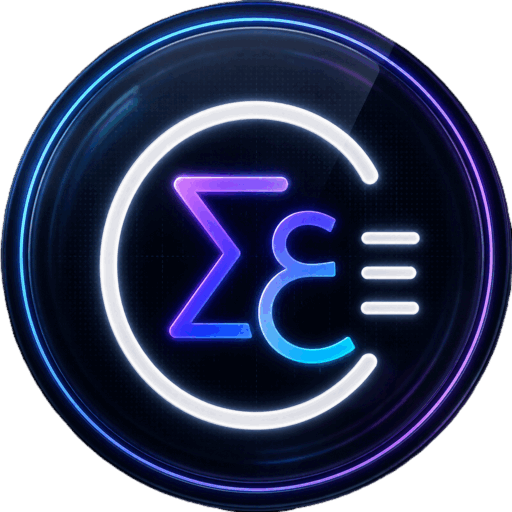
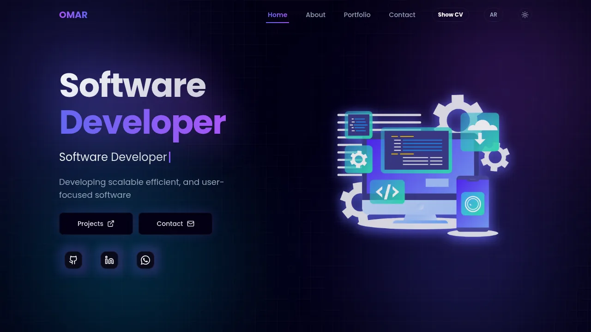

<h1>
  
  My Portfolio
</h1>

My premium personal portfolio with glassmorphism design, multi-language support (EN/AR), a Supabase-backed admin dashboard, and comments that refresh from Supabase.

<p>
  
  
  
  
  
  
  
</p>

🌐 **Live:** [omar-el-khouly.vercel.app](https://omar-el-khouly.vercel.app)

<p align="center">
  
</p>

---

## Features

| Feature | Description |
|---|---|
| **Glassmorphism UI** | Modern design with smooth animations (Framer Motion, AOS, Lottie) |
| **Multi-Language** | Fully translated English & Arabic with RTL support |
| **Admin Dashboard** | Secure management of projects, certificates, and comments |
| **Comments** | Supabase comment system with pin/unpin, delete, and freeze controls; public list refreshes every 30 seconds (polling, not a realtime subscription) |
| **Supabase Backend** | Database, authentication, and storage via Supabase |
| **PWA** | Installable progressive web app — install button (desktop hero + mobile menu) + auto-update toast |
| **SEO Optimized** | Meta tags, sitemap, and robots.txt configured |

## Visual identity

The portfolio's own palette is deep-space indigo with violet gradients, glass
surfaces, and cyan details—not a shared hub theme.

| Theme | Canvas | Primary accent | Secondary accent |
|---|---|---|---|
| Dark |  `#030014` |  `#6366f1` |  `#a855f7` |
| Light |  `#f8fafc` |  `#4f46e5` |  `#9333ea` |

See the [visual identity guide](docs/visual-identity.md) for palette details
and links to the theme source. A [mobile preview](public/screenshots/mobile.png)
is also available.

## Tech Stack

| Layer | Library / Tool |
|---|---|
| **Framework** | [React 18](https://react.dev) + [Vite](https://vite.dev) |
| **Styling** | [Tailwind CSS](https://tailwindcss.com) + [Material UI](https://mui.com) |
| **Animations** | [Framer Motion](https://www.framer.com/motion), [AOS](https://michalsnik.github.io/aos/), [Lottie](https://airbnb.io/lottie/) |
| **Backend** | [Supabase](https://supabase.com) (Auth, DB, Storage, Realtime) |
| **Alerts** | [SweetAlert2](https://sweetalert2.github.io) |
| **Fonts** | Poppins (Latin), Cairo (Arabic) |

## Structure

```
my-portfolio/
├── public/
│   ├── tools/              # Tech stack icons (SVG)
│   ├── icons/              # PWA icons (favicon.svg/png, 192/512, maskable, apple-touch)
│   ├── images/             # Open Graph image, profile photos
│   ├── screenshots/        # PWA install screenshots (desktop/mobile)
│   ├── documents/          # Downloadable CV (PDF)
│   ├── animations/         # Lottie animation data
│   ├── fonts/              # Poppins (Latin) + Cairo (Arabic) woff2
│   ├── robots.txt          # Search engine + AI crawler rules
│   └── sitemap.xml         # Auto-generated on build
├── src/
│   ├── components/         # Shared components (Navbar, Footer, Loader, CVModal, …)
│   │   └── dashboard/      # Dashboard UI components
│   ├── Pages/              # Page components (Home, About, Portfolio, Contact, CV)
│   │   └── dashboard/      # Admin dashboard pages
│   ├── context/            # Theme + shared data contexts
│   ├── hooks/              # Custom hooks (usePWAInstall, useAOS, …)
│   ├── assets/             # Static assets
│   ├── App.tsx
│   ├── main.tsx
│   └── index.css           # Global styles & theme variables
├── scripts/                # Build scripts — sitemap, icons, screenshots, perf-audit
├── dev/                    # Plans, specs, SQL schema, lighthouse reports
├── index.html
├── vite.config.js          # Vite + VitePWA config (manifest, routing, caching)
└── package.json
```

## Documentation

The full documentation set is in [`docs/`](docs/README.md), including the
pre-existing [visual identity guide](docs/visual-identity.md) and an index of
the plans and SQL notes in `dev/`.

| Page | What it covers |
| --- | --- |
| [Product](docs/product.md) | Features, audience, and known gaps |
| [Architecture](docs/architecture.md) | Routes, state, Supabase flow, PWA pipeline |
| [Development](docs/development.md) | Setup, commands, conventions, troubleshooting |
| [Configuration](docs/configuration.md) | Env vars, config files, storage keys, security |
| [Testing](docs/testing.md) | No test script, `perf:audit`, Lighthouse snapshots |
| [Deployment](docs/deployment.md) | Build, `dist/`, Vercel rewrite, prerequisites |
| [Changelog](docs/changelog.md) | Release notes status |

## Commands

| Command | Script |
| --- | --- |
| `npm run dev` | `vite` |
| `npm run sitemap` | `node scripts/generate-sitemap.mjs` |
| `npm run build` | `tsc --noEmit && node scripts/generate-sitemap.mjs && vite build` |
| `npm run lint` | `eslint .` |
| `npm run typecheck` | `tsc --noEmit` |
| `npm run perf:audit` | `node scripts/perf-audit.mjs` (requires a URL argument) |
| `npm run preview` | `vite preview` |

There is no `test` script in `package.json`.

## Getting Started

### Prerequisites
- Node.js 18+
- A [Supabase](https://supabase.com) project (free tier)

### Install

```bash
git clone https://github.com/Omar-Khaled-57/my-portfolio.git
cd my-portfolio
npm install
```

### Environment

Create `.env` (see [`.env.example`](.env.example)):
```env
VITE_SUPABASE_URL=your_supabase_url
VITE_SUPABASE_ANON_KEY=your_supabase_anon_key
```

Optional variables used by tooling: `DATABASE_URL` (server-side/CLI only),
`SITE_URL` (sitemap base URL, defaults to the live site), and `CHROME_PATH` /
`URL` for the screenshot and Lighthouse scripts. See
[configuration](docs/configuration.md) for defaults and security notes.

### Run

```bash
npm run dev
```

Build for production:
```bash
npm run build
```

## Supabase Setup

Run the SQL in [`dev/sqls/001_full_schema.sql`](dev/sqls/001_full_schema.sql) (see [`dev/sqls/README.md`](dev/sqls/README.md)) to create the tables, enable RLS, and configure storage buckets. Then create your admin user via **Authentication → Users**, copy their UUID, and insert into `profiles`:

```sql
INSERT INTO public.profiles (id, username, role)
VALUES ('YOUR_USER_ID', 'admin', 'admin');
```

## License

This project is for personal use. Feel free to use it as inspiration for your own portfolio!

A standard MIT [LICENSE](LICENSE) (`Copyright (c) 2026 Omar Khaled`) is included
for the repository; the original note above is retained.

## Contact

Me — [GitHub](https://github.com/Omar-Khaled-57) · [WhatsApp](https://wa.me/201123029406) · [Portfolio](https://omar-el-khouly.vercel.app)
